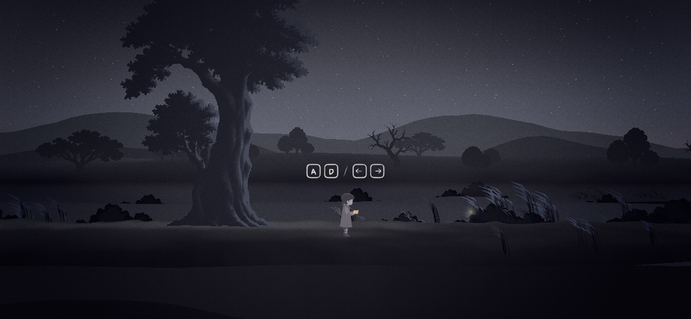
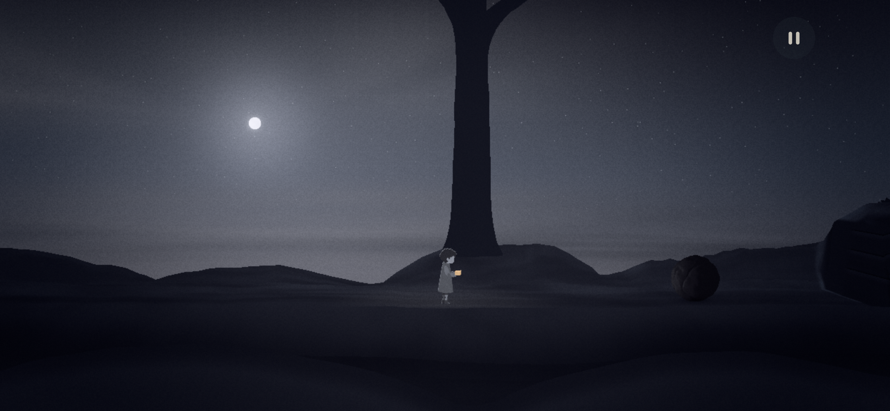
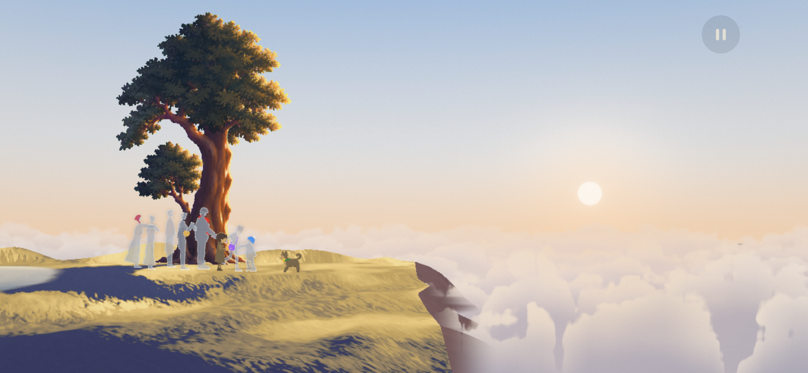

# Go Home · Flutter 移动版

根据用户提供的 `GoHome-mac-ae17e809.zip` 移植的横屏 iOS / Android 游戏。使用 **Dart three_js 0.3.0 + flutter_angle** 原生渲染，Flutter 承担触控、菜单、存档与原生音频；游戏逻辑运行在 Dart 中。

主线已恢复原版约 840 单位的连续道路、全部八个动物机关、开场起身和完整回家结尾。地形、植被、角色图集、原着色器、路线色板、镜头、主角步态/IK 和家人编排均从发行版恢复。应用不包含 WebView，不执行原 JavaScript，也不需要网页服务器。

普通主线已使用原生逐声部动态配乐，按位置、解谜与乐句变化，包含环境音、空间状态和远处哼唱。大熊完整步态/呼吸/惯性、结尾动物、小狗和艺术萤火虫已补充原作参考对照；家人双手抱起、手掌角度、母亲前倾与接触锚点已接入实际场景。开场萤火虫使用显式 GLSL、原纹理及尺寸/光强计算。

**这份交付仍不能标为“已验证百分之百一致”。** 原生音频 DSP 和触控界面与桌面后端不同，尚未完成全流程逐像素、逐采样对比及 Android/iOS 真机长期验收。具体边界见 [移植说明](docs/PORTING.md)。

## 运行

固定使用 **Flutter 3.47.1 / Dart 3.13.1**（`.fvmrc`）。旧版 Flutter 3.35.7 在本机编译 flutter_angle FFI 时出现编译器异常。

```bash
fvm use 3.47.1
fvm flutter pub get
fvm flutter run -d <设备ID>
```

当前机器也可使用 `/Users/huangji/fvm/versions/3.47.1/bin/flutter`。

- iOS：最低 iOS 15；使用 Xcode / CocoaPods，打开 `ios/Runner.xcworkspace`。真机安装需要设置自己的开发团队和签名。
- Android：最低 API 24，目标 API 36；JDK 17+，NDK 28.2.13676358，CMake 3.31.4。当前原生插件提供 ARM64 库，体验包面向 arm64-v8a 手机。

```bash
fvm flutter build apk --release --target-platform android-arm64
fvm flutter build ios --release --no-codesign
```

Android release 当前使用模板调试签名，供本地体验。iOS 的 unsigned Runner.app 仅为真机构建检查，不能直接安装为已签名 IPA。

## 首次启动

应用图标使用原 macOS 发行包声明的 `electron.icns`，保留原画面，只缩放为 iOS/Android 要求的尺寸，不再拼画角色或新增背景。原文件和校验记录位于 `resources/original_app_icon/`，重建时运行 `python3 ../tools/generate_mobile_icons.py` 即可。更换源文件须显式传入 `--source <原版ZIP/app/icns/png>`。


加载期间显示原版手绘耳机和呼吸小点。资源就绪后点按继续，首次进入原试听音轨与手绘音量滑块，点“完成”保存总音量；再次启动跳过已完成的音量校准。雾幕以原版噪声场阈值消散，随后萤火虫飞入音乐盒，标题按原 b 版裁剪、模糊与菜单分批过渡出现。原生系统启动底色也改为相同灰蓝渐变。

[查看原生启动截图](docs/startup-preview.jpg)。

## 设置

设置采用发行版 KN 的透明双列布局、Gaegu/Xiaolai 字体、手绘选中圈/下划线与音符滑块；从主菜单进入时保留标题并隐藏菜单行及右下语言入口。总音量、音乐和音效以 0.05 步进保存；画质即时改变原生渲染分辨率和草/树叶实例密度。数字提示有自动、开、关三种存档值，默认路线中自动和开均使用原版 num 行为；关闭隐藏普通数字层，保留独立教学和结尾演奏提示。

重新试音在同侧区域播放原版 tuning-c1，暂时压低主配乐；点“好了 / Done”保存，Esc 取消恢复原音量，不重播首次启动流程。设置打开时隔离游戏输入；方向键/WASD 选择与调整，Enter/空格确认，Esc 返回。移动端无浏览器全屏能力，因此按原版能力判断不显示全屏项。

[查看设置截图](docs/settings-preview.jpg)。

## 暂停

右上角原版手绘三线入口或 Esc/P 打开暂停。右侧三行仅提供“继续 / Resume”“设置 / Settings”“回到主菜单 / Back to main menu”，沿用原版 9% 边距、18–26 字号、手绘圈/金色小点、纸纹侧雾和 0.35 秒进出；选择圈逐笔出现并每 200ms 重绘，点击文字有压缩回弹，确认延迟 200ms。按上下/W/S 选择，Enter/空格确认，Esc/P 继续；设置返回保留当前行，返回标题保留进度。暂停期间世界时钟与动作冻结，场景提示以 250ms 淡出、恢复后以 400ms 淡入。

[查看暂停截图](docs/pause-preview.jpg)。

## 操作

进入游戏、暂停后继续或切回前台时会自动收起系统状态栏与底部导航栏，保留边缘滑动临时呼出系统栏的能力。Android 使用原生 WindowInsets 接口兼容目标 API 36 的全屏显示；iOS 同时隐藏状态栏与底部主屏幕指示条。

已移除移动端额外的键盘 HUD、方向键、旋律答案和操作文案。提示改为原版场景内的手绘移动/跳跃键帽、向右推物手势、耳朵/J、萤火虫数字圈、音乐盒、听音光点及回应圈；保留“半夜 / MIDNIGHT”“天亮 / DAWN”章节字幕。推物提示在同高度从左侧靠近石球或蜷起的刺猬时出现，主动推离初始位置 0.3 单位后淡出，不受数字提示开关影响。

右下角恢复原版场景进程标识：九个节点的手绘路线与终点树，在进入场景或实际通过场景时播放落光、节点亮起和回弹，2.8 秒后淡出。场景完成记录随进度保存，暂停冻结动画；标识不拦截触控。

横屏触控区不绘制按钮：屏幕下方 37% 为操作区，其中最左 22% 的左右两半分别向左/向右，中间 22%–82% 从左至右为音符 1–7，最右 18% 为跳跃；上方区域点按聆听附近动物。和弦支持多指同时按。结尾握手提示出现后点按屏幕弹奏 1。设置按原版提供总音量、音乐、音效、语言、三档画质、数字提示和重新试音；啄木鸟机关仍检查节奏。

键盘：方向键 / A、D 移动，空格 / W 跳跃，数字 1–7 弹奏，J 重听，Esc/P 暂停。暂停与切到后台会冻结游戏；进度存储在本机，章节菜单可重玩已到达的位置。

## 主要代码

| 路径 | 职责 |
| --- | --- |
| `lib/game/original_world_view.dart` | 实际运行的原版连续世界、流式场景与原生渲染 |
| `lib/game/native_world_assets.dart` | 原网格、实例属性、材质、纹理与共享 shader 参数 |
| `lib/game/native_postprocess.dart` | 原版后期、颗粒、暗角及颜色处理 |
| `lib/game/original_route*.dart`、`route_camera.dart` | 连续路线、色板及镜头 |
| `lib/game/original_boy_*.dart`、`boy_kinematics.dart` | 主角跑跳、转身、坡面脚步、推物与摇柄 IK |
| `lib/game/original_family.dart` | 十种家人骨骼、坐姿、视线、手掌 IK 与接触点 |
| `lib/game/original_bear_motion.dart`、`native_bear_view.dart` | 大熊原作步态、呼吸、惯性、转身、涉水和水面 shader |
| `lib/game/original_startup.dart`、`lib/ui/original_startup_overlay.dart`、`shaders/startup_fog.frag` | 首次耳机/音量流程和原噪声雾幕片元着色器 |
| `lib/ui/original_settings.dart`、`original_side_fog.dart` | 原版透明设置、音符滑块、侧边试音与纸纹雾层 |
| `lib/ui/original_start_menu.dart` | 原 b 版标题、菜单行和离场过渡 |
| `lib/ui/original_pause_menu.dart` | 原 H 暂停三行、手绘入口、逐笔选中圈与确认/返回流程 |
| `lib/game/native_firefly_light.dart`、`original_firefly_light.dart` | 开场/引导萤火虫 GLSL、原纹理、尺寸和光照衰减 |
| `lib/game/native_artist_firefly.dart`、`original_artist_firefly.dart` | 结尾艺术萤火虫矢量动作和原 GLSL 调色合成 |
| `lib/game/original_*.dart` | 八个动物的原版逻辑、物理、节拍窗口及剧情 |
| `lib/game/original_ending*.dart` | 骑熊、家人入场、变换、告别、飞行及返回菜单 |
| `lib/game/original_route_music.dart`、`original_call_music.dart`、`original_route_environment.dart` | 原作动态配乐导演、和声、空间状态和环境调度 |
| `lib/game/native_route_audio.dart`、`audio_engine.dart` | 原生 PCM 逐声部播放、音符/示范、结尾音乐与暂停对时 |
| `lib/game/native_game_hints.dart`、`original_*hint*.dart` | 原作场景内提示、原纹理及提示动画 |
| `lib/ui/game_screen.dart`、`transparent_game_input.dart` | 无可见 HUD 的多点触控、菜单、暂停、设置与章节字幕 |

`world_view.dart` 为早期兼容渲染器；实际 `main.dart` 使用 `OriginalWorldView`。

## 验证

```bash
fvm flutter analyze --no-pub
fvm flutter test --no-pub --reporter expanded
fvm flutter test --no-pub integration_test/original_world_test.dart -d <iOS模拟器ID> --reporter expanded
```

193 项单元/数值对照测试通过，原生集成测试及构建记录见 [验证记录](docs/VALIDATION.md)。资源和依赖归属见 [第三方说明](THIRD_PARTY_NOTICES.md)。






