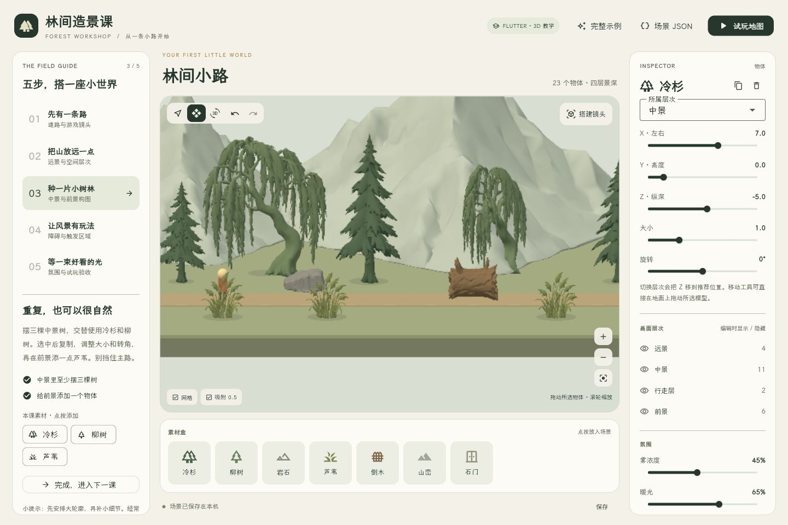

# 林间造景课 · Flutter 场景搭建教学 Demo

独立于 `go_home_mobile` 的 Flutter 工程。使用 Dart `three_js` 渲染真实 3D 模型，Flutter 负责教学、编辑工具、存档与输入。不依赖 Three.js Editor，也不使用 WebView。已经内置七种经过修复、归一化的模型，复制本目录即可运行。



## 开始运行

固定 Flutter **3.47.1 / Dart 3.13.1**，版本记录在 `.fvmrc`。

```sh
fvm use 3.47.1
fvm flutter pub get
fvm flutter run -d chrome
```

iOS / Android：

```sh
fvm flutter devices
fvm flutter run -d <设备ID>
```

当前机器也可直接使用 `/Users/huangji/fvm/versions/3.47.1/bin/flutter`。iOS 需要 Xcode 和 CocoaPods，真机需要自己的开发团队签名；Android 需要 Android SDK、JDK 和 NDK。浏览器需要 WebGL2。`web/gles_bindings.js` 已本地打包，无须另加远程脚本。

## 跟着做一遍

1. **先有一条路**：点「铺设第一条路」，再点画面右上角「游戏镜头」。确认角色与道路的尺度，然后进入下一课。
2. **把山放远一点**：点两次「山峦」。选中模型后，在物体面板调整 X 和大小，做出一大一小、前后错开的远山。
3. **种一片小树林**：放三棵冷杉 / 柳树。用复制、旋转、缩放打破重复；添加前景芦苇。点「旋转视角」拖动观察层次。
4. **让风景有玩法**：把倒木放在 X=-3、Z=0；石门放在 X=9、Z=0，均归入行走层。金色圆圈表示互动范围。
5. **等一束好看的光**：调节雾浓度和暖光，点「试玩地图」走完全程。最后打开「场景 JSON」复制数据保存。

想先看成品：宽屏右上角点「完整示例」；窄屏点标题栏「… → 载入完整示例」。完整示例仍然可以继续编辑。

可直接导入的示例数据：[examples/forest_path.json](examples/forest_path.json)。

## 编辑操作

| 操作 | 方法 |
| --- | --- |
| 添加 | 点素材盒或本课素材，模型自动进入推荐层次 |
| 选择 | 点场景里的模型；金色环表示选中 |
| 移动 | 选中后切换移动工具，在画面中拖动；或调整属性面板 X/Y/Z |
| 旋转 / 缩放模型 | 属性面板「旋转」「大小」 |
| 复制 / 删除 | 属性标题旁的两个按钮 |
| 旋转镜头 | 切换「旋转视角」，拖动空白画面 |
| 缩放镜头 | 滚轮、双指或画面右侧 +/− |
| 显隐层次 | 属性面板眼睛图标；只影响编辑视图 |
| 吸附 | 开启后，拖动吸附到 0.5 单位；属性滑杆仍允许精细调整 |
| 撤销重做 | 画面左上角按钮；一次拖动或一次滑杆调整算一个操作 |
| 新建场景 | 属性面板底部或窄屏「…」菜单，可撤销 |

试玩：**A/D 或左右方向键**移动，**空格/W**跳跃，**E**互动，**Esc**退出。触屏使用画面下方按钮；左右按钮需要按住。靠近石门 3 单位内点互动。角色到达 X=16.5 后显示完成提示。

## 坐标与地图数据

- **X**：沿道路左右行进；道路范围 -18 到 18，角色范围 -17 到 17。
- **Y**：离地高度；地面为 0。
- **Z**：前后纵深；远景推荐 -15，中景 -5，行走层 0，前景 5。

场景每次修改后延迟 650ms 自动保存到本机 `shared_preferences`；也可主动点保存。浏览器存档跟随当前来源地址，切换端口 / 浏览器不会共享存档。用 JSON 可以跨设备转移。

导出的 `forest-workshop` v1 JSON 包含道路开关、模型类型、变换、层次、雾、光线和课程编号。导入会先验证版本、坐标范围、重复 ID、物体上限，再整体替换场景；导入可以撤销。**这是本 Demo 的场景格式，尚未接入原 Go Home 工程的加载器。**

## 代码从哪里读

| 文件 | 学习内容 |
| --- | --- |
| `lib/main.dart` | 五课教学、响应式面板、素材盒、属性编辑、输入和 JSON 窗口 |
| `lib/scene_document.dart` | 不依赖渲染器的场景模型、JSON 校验、完整示例、试玩碰撞 |
| `lib/workshop_controller.dart` | 编辑命令、合并拖动历史、课程检查、自动保存与恢复 |
| `lib/scene_viewport.dart` | 模型加载复用、材质和雾、相机、射线选择、地面拖拽、角色和开门动画 |
| `tool/prepare_models.py` | 去除源 GLB 失效贴图引用，居中、贴地，归一化最长边为 1 |
| `test/workshop_test.dart` | 场景数据、编辑历史、存档与试玩行为测试 |

建议按「数据 → 编辑命令 → 3D 显示 → Flutter 面板」的顺序阅读。场景数据与渲染分开，便于以后接入地形编辑、GLB 导出或原游戏。

## 教学范围

这是可操作的小型教学编辑器，包含固定道路、模型布局、四层景深、基础光雾和试玩。

- 材质采用教学配色，模型不含原作的专用着色器、叶片动画和后期效果。
- 障碍是简化碰撞盒；Y 高度、大小影响碰撞，旋转不改变碰撞盒。试玩仅处理行走层、Z 接近道路的倒木 / 岩石 / 石门。
- 试玩开门会抬起整组石门，属于交互演示；不包含原作的解谜机制。
- 编辑时可隐藏层次，试玩仍显示完整场景并保留碰撞。
- 不包含自由雕刻地形、完整物理引擎、通用外部模型导入、GLB 导出或原游戏一键地图替换。
- 本地存档与 JSON 只保存场景配置；模型随工程打包。

## 构建与检查

```sh
fvm flutter analyze --no-pub
fvm flutter test --no-pub
fvm flutter build web --release --no-web-resources-cdn
fvm flutter build ios --simulator --debug --no-pub
```

模型与依赖署名见 [THIRD_PARTY_NOTICES.md](THIRD_PARTY_NOTICES.md)。重新生成素材时运行：

```sh
python3 tool/prepare_models.py ../go_home_mobile/assets/models
```

已执行的检查与平台边界见 [验证记录](docs/VALIDATION.md)。

## 新增：参照图一建模的立体花园

现在默认首页为「花间造景课」，包含花屋、花拱门、栅栏等独立模型与完整花园构图，支持参考镜头、旋转检查和逐件编辑。原来的林间基础课可从右上角进入，存档相互独立。

当前版本已替换早期的图片绘景，花屋、花瓣、叶片、栅栏、远山和云均使用三维几何。支持单体查看、侧面、背面、线框和开合花屋门。具体制作方式、范围和重建方法见 [立体花园说明](docs/garden3d/README.md)。完整模型为 `assets/models/garden3d_complete.glb`，场景预设为 `examples/flower_garden_3d.json`。旧 `garden_*.glb` 与 `docs/garden/` 仅保留制作历史，应用当前使用 `garden3d_*.glb`。
